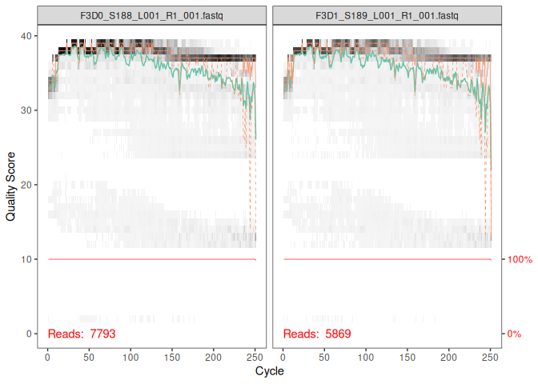
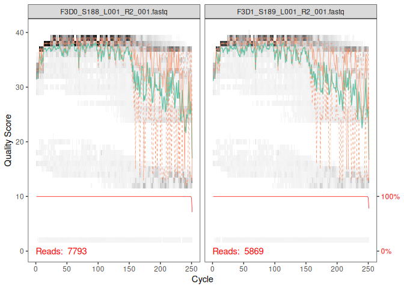
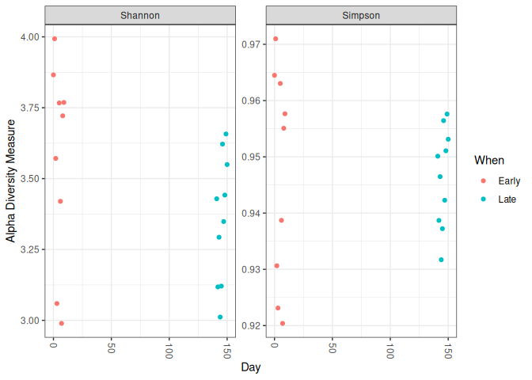
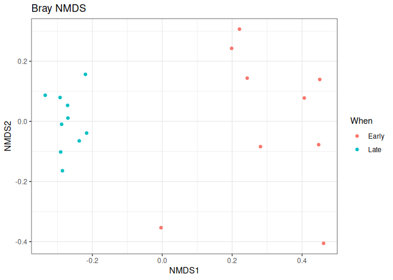

R Notebook
================
Emilie Jeanson

Ce notebook est produit au format `github_document` : le fichier `.md`
généré peut être poussé sur GitHub pour conserver le code et les
sorties.

Le [tutoriel DADA2](https://benjjneb.github.io/dada2/tutorial.html)
(pipeline *MiSeq SOP*) : lectures brutes (fastq) à une table d’ASV
(variants de séquence d’amplicon) avec leur taxonomie, puis à des
analyses de diversité avec `phyloseq`.

# 1. Préparation des données

## Chargement de DADA2

``` r
# library() charge le package dans la session R
# packageVersion() affiche sa version (utile pour la reproductibilité)
library(dada2); packageVersion("dada2")
```

    ## Loading required package: Rcpp

    ## [1] '1.40.0'

## Téléchargement du jeu de données

Le *MiSeq SOP* est le jeu de données du laboratoire Schloss, qui a
publié l’article de référence. Il s’agit de séquences 16S issues de
fèces de souris, séquencées en MiSeq. On le télécharge avec `wget`
(chunk `bash`, donc exécuté dans le terminal et non dans R), puis on le
décompresse avec `unzip`.

``` bash
# wget : télécharge un fichier depuis une URL (-nc : ne retélécharge pas si le fichier existe déjà)
# unzip : décompresse l'archive .zip (-o : écrase sans poser de question)
wget -nc https://mothur.s3.us-east-2.amazonaws.com/wiki/miseqsopdata.zip
unzip -o miseqsopdata.zip
```

## Chemin vers les fichiers fastq

On crée un nouvel objet `path` qui contient du texte : le chemin du
dossier où se trouvent les fichiers fastq décompressés.

``` r
# "<-" assigne une valeur à un objet
path <- "/home/rstudio/Dada2/MiSeq_SOP" # CHANGE ME to the directory containing the fastq files after unzipping.
# list.files() liste le contenu du dossier : permet de vérifier que les fichiers sont bien là
list.files(path)
```

    ##  [1] "F3D0_S188_L001_R1_001.fastq"   "F3D0_S188_L001_R2_001.fastq"  
    ##  [3] "F3D1_S189_L001_R1_001.fastq"   "F3D1_S189_L001_R2_001.fastq"  
    ##  [5] "F3D141_S207_L001_R1_001.fastq" "F3D141_S207_L001_R2_001.fastq"
    ##  [7] "F3D142_S208_L001_R1_001.fastq" "F3D142_S208_L001_R2_001.fastq"
    ##  [9] "F3D143_S209_L001_R1_001.fastq" "F3D143_S209_L001_R2_001.fastq"
    ## [11] "F3D144_S210_L001_R1_001.fastq" "F3D144_S210_L001_R2_001.fastq"
    ## [13] "F3D145_S211_L001_R1_001.fastq" "F3D145_S211_L001_R2_001.fastq"
    ## [15] "F3D146_S212_L001_R1_001.fastq" "F3D146_S212_L001_R2_001.fastq"
    ## [17] "F3D147_S213_L001_R1_001.fastq" "F3D147_S213_L001_R2_001.fastq"
    ## [19] "F3D148_S214_L001_R1_001.fastq" "F3D148_S214_L001_R2_001.fastq"
    ## [21] "F3D149_S215_L001_R1_001.fastq" "F3D149_S215_L001_R2_001.fastq"
    ## [23] "F3D150_S216_L001_R1_001.fastq" "F3D150_S216_L001_R2_001.fastq"
    ## [25] "F3D2_S190_L001_R1_001.fastq"   "F3D2_S190_L001_R2_001.fastq"  
    ## [27] "F3D3_S191_L001_R1_001.fastq"   "F3D3_S191_L001_R2_001.fastq"  
    ## [29] "F3D5_S193_L001_R1_001.fastq"   "F3D5_S193_L001_R2_001.fastq"  
    ## [31] "F3D6_S194_L001_R1_001.fastq"   "F3D6_S194_L001_R2_001.fastq"  
    ## [33] "F3D7_S195_L001_R1_001.fastq"   "F3D7_S195_L001_R2_001.fastq"  
    ## [35] "F3D8_S196_L001_R1_001.fastq"   "F3D8_S196_L001_R2_001.fastq"  
    ## [37] "F3D9_S197_L001_R1_001.fastq"   "F3D9_S197_L001_R2_001.fastq"  
    ## [39] "filtered"                      "HMP_MOCK.v35.fasta"           
    ## [41] "Mock_S280_L001_R1_001.fastq"   "Mock_S280_L001_R2_001.fastq"  
    ## [43] "mouse.dpw.metadata"            "mouse.time.design"            
    ## [45] "stability.batch"               "stability.files"

## Séparation des lectures forward (R1) et reverse (R2)

Étape spécifique aux noms de fichiers de ce jeu de données : chaque
échantillon a deux fichiers, un pour les lectures **forward** (R1) et un
pour les lectures **reverse** (R2). On les sépare dans deux vecteurs,
puis on extrait le nom de chaque échantillon à partir du nom de fichier
(stratégie de double indexation de l’article).

``` r
# Forward and reverse fastq filenames have format: SAMPLENAME_R1_001.fastq and SAMPLENAME_R2_001.fastq
# pattern= : ne garde que les fichiers dont le nom contient cette chaîne
# full.names = TRUE : renvoie le chemin complet et pas seulement le nom du fichier
# sort() : trie par ordre alphabétique, pour que F et R restent dans le même ordre
fnFs <- sort(list.files(path, pattern="_R1_001.fastq", full.names = TRUE))
fnRs <- sort(list.files(path, pattern="_R2_001.fastq", full.names = TRUE))
# Extract sample names, assuming filenames have format: SAMPLENAME_XXX.fastq
# basename() : retire le chemin et garde le nom du fichier
# strsplit(..., "_") : coupe le nom à chaque "_"
# sapply(..., `[`, 1) : garde le 1er morceau de chaque nom = le nom de l'échantillon
sample.names <- sapply(strsplit(basename(fnFs), "_"), `[`, 1)
```

# 2. Contrôle qualité et filtrage

## Profils de qualité

On regarde la qualité (score Phred) en fonction de la position dans la
lecture, pour choisir où tronquer. Ici on ne regarde que les 2 premiers
échantillons (`[1:2]`). En général, la qualité des lectures reverse est
moins bonne que celle des lectures forward.

``` r
# plotQualityProfile() : graphique de la qualité par position des bases
plotQualityProfile(fnFs[1:2])
```

<!-- -->

``` r
plotQualityProfile(fnRs[1:2])
```

<!-- -->

## Définition des fichiers filtrés

On prépare les chemins des futurs fichiers filtrés, dans un sous-dossier
`filtered/`. Les noms des vecteurs sont fixés aux noms d’échantillons,
ce qui permet de s’y référer facilement ensuite.

``` r
# Place filtered files in filtered/ subdirectory
# file.path() : assemble les morceaux d'un chemin
# paste0() : colle des chaînes de caractères sans espace
filtFs <- file.path(path, "filtered", paste0(sample.names, "_F_filt.fastq.gz"))
filtRs <- file.path(path, "filtered", paste0(sample.names, "_R_filt.fastq.gz"))
# names() : donne un nom à chaque élément du vecteur
names(filtFs) <- sample.names
names(filtRs) <- sample.names
```

## Filtrage et troncature

On filtre les lectures de mauvaise qualité. Paramètres utilisés :

- `truncLen=c(240,160)` : tronque les lectures forward à 240 pb et les
  reverse à 160 pb (les lectures plus courtes sont éliminées). Les
  valeurs sont choisies d’après les profils de qualité, tout en gardant
  assez de chevauchement pour fusionner F et R ensuite.
- `maxN=0` : aucune base ambiguë (N) autorisée.
- `maxEE=c(2,2)` : nombre maximal d’erreurs attendues (*expected
  errors*) par lecture, F et R.
- `truncQ=2` : tronque une lecture à la première base de qualité ≤ 2.
- `rm.phix=TRUE` : retire les séquences du phage PhiX (témoin ajouté
  lors du séquençage Illumina).

``` r
# filterAndTrim() : filtre et tronque les lectures, écrit les fichiers filtrés
# compress = TRUE : fichiers de sortie compressés en .gz
# multithread = 2 : utilise 2 cœurs de calcul
out <- filterAndTrim(fnFs, filtFs, fnRs, filtRs, truncLen=c(240,160),
              maxN=0, maxEE=c(2,2), truncQ=2, rm.phix=TRUE,
              compress=TRUE, multithread=2)
# head() : affiche les premières lignes (nombre de lectures avant / après filtrage)
head(out)
```

    ##                               reads.in reads.out
    ## F3D0_S188_L001_R1_001.fastq       7793      7113
    ## F3D1_S189_L001_R1_001.fastq       5869      5299
    ## F3D141_S207_L001_R1_001.fastq     5958      5463
    ## F3D142_S208_L001_R1_001.fastq     3183      2914
    ## F3D143_S209_L001_R1_001.fastq     3178      2941
    ## F3D144_S210_L001_R1_001.fastq     4827      4312

# 3. Modèle d’erreur et inférence des ASV

## Apprentissage du modèle d’erreur

DADA2 apprend le taux d’erreur de séquençage propre à ce jeu de données,
séparément pour les lectures forward et reverse. Ce modèle sert ensuite
à distinguer les vraies variations biologiques des erreurs de
séquençage.

``` r
# learnErrors() : estime les taux d'erreur à partir des données
errF <- learnErrors(filtFs, multithread=TRUE)
```

    ## 33514080 total bases in 139642 reads from 20 samples will be used for learning the error rates.

``` r
errR <- learnErrors(filtRs, multithread=TRUE)
```

    ## 22342720 total bases in 139642 reads from 20 samples will be used for learning the error rates.

On vérifie visuellement que le modèle d’erreur (ligne noire) colle aux
erreurs observées (points) et que le taux d’erreur diminue quand la
qualité augmente. La ligne rouge correspond au taux attendu
théoriquement.

``` r
# nominalQ = TRUE : ajoute la ligne rouge du taux d'erreur nominal
plotErrors(errF, nominalQ=TRUE)
```

    ## Warning in scale_y_log10(): log-10 transformation introduced infinite values.

    ## Warning: Removed 164 rows containing missing values or values outside the scale range
    ## (`geom_line()`).
    ## Removed 164 rows containing missing values or values outside the scale range
    ## (`geom_line()`).

<!-- -->

## Inférence des variants de séquence (débruitage)

C’est l’étape centrale de DADA2 : l’algorithme utilise le modèle
d’erreur pour décider quelles séquences sont de vrais variants (ASV) et
lesquelles sont des erreurs de séquençage.

``` r
# dada() : algorithme de débruitage, renvoie les ASV inférées pour chaque échantillon
dadaFs <- dada(filtFs, err=errF, multithread=TRUE)
```

    ## Sample 1 - 7113 reads in 1979 unique sequences.
    ## Sample 2 - 5299 reads in 1639 unique sequences.
    ## Sample 3 - 5463 reads in 1477 unique sequences.
    ## Sample 4 - 2914 reads in 904 unique sequences.
    ## Sample 5 - 2941 reads in 939 unique sequences.
    ## Sample 6 - 4312 reads in 1267 unique sequences.
    ## Sample 7 - 6741 reads in 1756 unique sequences.
    ## Sample 8 - 4560 reads in 1438 unique sequences.
    ## Sample 9 - 15637 reads in 3590 unique sequences.
    ## Sample 10 - 11413 reads in 2762 unique sequences.
    ## Sample 11 - 12017 reads in 3021 unique sequences.
    ## Sample 12 - 5032 reads in 1566 unique sequences.
    ## Sample 13 - 18075 reads in 3707 unique sequences.
    ## Sample 14 - 6250 reads in 1479 unique sequences.
    ## Sample 15 - 4052 reads in 1195 unique sequences.
    ## Sample 16 - 7369 reads in 1832 unique sequences.
    ## Sample 17 - 4765 reads in 1183 unique sequences.
    ## Sample 18 - 4871 reads in 1382 unique sequences.
    ## Sample 19 - 6504 reads in 1709 unique sequences.
    ## Sample 20 - 4314 reads in 897 unique sequences.

``` r
dadaRs <- dada(filtRs, err=errR, multithread=TRUE)
```

    ## Sample 1 - 7113 reads in 1660 unique sequences.
    ## Sample 2 - 5299 reads in 1349 unique sequences.
    ## Sample 3 - 5463 reads in 1335 unique sequences.
    ## Sample 4 - 2914 reads in 853 unique sequences.
    ## Sample 5 - 2941 reads in 880 unique sequences.
    ## Sample 6 - 4312 reads in 1286 unique sequences.
    ## Sample 7 - 6741 reads in 1803 unique sequences.
    ## Sample 8 - 4560 reads in 1265 unique sequences.
    ## Sample 9 - 15637 reads in 3414 unique sequences.
    ## Sample 10 - 11413 reads in 2522 unique sequences.
    ## Sample 11 - 12017 reads in 2771 unique sequences.
    ## Sample 12 - 5032 reads in 1415 unique sequences.
    ## Sample 13 - 18075 reads in 3290 unique sequences.
    ## Sample 14 - 6250 reads in 1390 unique sequences.
    ## Sample 15 - 4052 reads in 1134 unique sequences.
    ## Sample 16 - 7369 reads in 1635 unique sequences.
    ## Sample 17 - 4765 reads in 1084 unique sequences.
    ## Sample 18 - 4871 reads in 1161 unique sequences.
    ## Sample 19 - 6504 reads in 1502 unique sequences.
    ## Sample 20 - 4314 reads in 732 unique sequences.

``` r
# Affiche le résumé du 1er échantillon : nombre de séquences uniques -> nombre d'ASV
dadaFs[[1]]
```

    ## dada-class: object describing DADA2 denoising results
    ## 128 sequence variants were inferred from 1979 input unique sequences.
    ## Key parameters: OMEGA_A = 1e-40, OMEGA_C = 1e-40, BAND_SIZE = 16

# 4. Fusion des lectures et table de séquences

## Fusion des paires F et R

On fusionne chaque lecture forward avec sa lecture reverse
correspondante, grâce à leur zone de chevauchement, pour reconstituer la
séquence complète de la région amplifiée.

``` r
# mergePairs() : fusionne les paires de lectures qui se chevauchent
# verbose = TRUE : affiche le nombre de paires fusionnées par échantillon
mergers <- mergePairs(dadaFs, filtFs, dadaRs, filtRs, verbose=TRUE)
```

    ## 6540 paired-reads (in 107 unique pairings) successfully merged out of 6891 (in 197 pairings) input.

    ## 5028 paired-reads (in 101 unique pairings) successfully merged out of 5190 (in 157 pairings) input.

    ## 4986 paired-reads (in 81 unique pairings) successfully merged out of 5267 (in 166 pairings) input.

    ## 2595 paired-reads (in 52 unique pairings) successfully merged out of 2754 (in 108 pairings) input.

    ## 2553 paired-reads (in 60 unique pairings) successfully merged out of 2785 (in 119 pairings) input.

    ## 3646 paired-reads (in 55 unique pairings) successfully merged out of 4109 (in 157 pairings) input.

    ## 6079 paired-reads (in 81 unique pairings) successfully merged out of 6514 (in 198 pairings) input.

    ## 3968 paired-reads (in 91 unique pairings) successfully merged out of 4388 (in 187 pairings) input.

    ## 14233 paired-reads (in 143 unique pairings) successfully merged out of 15355 (in 352 pairings) input.

    ## 10528 paired-reads (in 120 unique pairings) successfully merged out of 11165 (in 278 pairings) input.

    ## 11154 paired-reads (in 137 unique pairings) successfully merged out of 11797 (in 298 pairings) input.

    ## 4349 paired-reads (in 85 unique pairings) successfully merged out of 4802 (in 179 pairings) input.

    ## 17431 paired-reads (in 153 unique pairings) successfully merged out of 17812 (in 272 pairings) input.

    ## 5850 paired-reads (in 81 unique pairings) successfully merged out of 6095 (in 159 pairings) input.

    ## 3716 paired-reads (in 86 unique pairings) successfully merged out of 3894 (in 147 pairings) input.

    ## 6865 paired-reads (in 99 unique pairings) successfully merged out of 7191 (in 187 pairings) input.

    ## 4426 paired-reads (in 67 unique pairings) successfully merged out of 4603 (in 127 pairings) input.

    ## 4576 paired-reads (in 101 unique pairings) successfully merged out of 4739 (in 174 pairings) input.

    ## 6092 paired-reads (in 109 unique pairings) successfully merged out of 6315 (in 173 pairings) input.

    ## 4269 paired-reads (in 20 unique pairings) successfully merged out of 4281 (in 28 pairings) input.

``` r
# Inspect the merger data.frame from the first sample
head(mergers[[1]])
```

    ##                                                                                                                                                                                                                                                       sequence
    ## 1 TACGGAGGATGCGAGCGTTATCCGGATTTATTGGGTTTAAAGGGTGCGCAGGCGGAAGATCAAGTCAGCGGTAAAATTGAGAGGCTCAACCTCTTCGAGCCGTTGAAACTGGTTTTCTTGAGTGAGCGAGAAGTATGCGGAATGCGTGGTGTAGCGGTGAAATGCATAGATATCACGCAGAACTCCGATTGCGAAGGCAGCATACCGGCGCTCAACTGACGCTCATGCACGAAAGTGTGGGTATCGAACAGG
    ## 2 TACGGAGGATGCGAGCGTTATCCGGATTTATTGGGTTTAAAGGGTGCGTAGGCGGCCTGCCAAGTCAGCGGTAAAATTGCGGGGCTCAACCCCGTACAGCCGTTGAAACTGCCGGGCTCGAGTGGGCGAGAAGTATGCGGAATGCGTGGTGTAGCGGTGAAATGCATAGATATCACGCAGAACCCCGATTGCGAAGGCAGCATACCGGCGCCCTACTGACGCTGAGGCACGAAAGTGCGGGGATCAAACAGG
    ## 3 TACGGAGGATGCGAGCGTTATCCGGATTTATTGGGTTTAAAGGGTGCGTAGGCGGGCTGTTAAGTCAGCGGTCAAATGTCGGGGCTCAACCCCGGCCTGCCGTTGAAACTGGCGGCCTCGAGTGGGCGAGAAGTATGCGGAATGCGTGGTGTAGCGGTGAAATGCATAGATATCACGCAGAACTCCGATTGCGAAGGCAGCATACCGGCGCCCGACTGACGCTGAGGCACGAAAGCGTGGGTATCGAACAGG
    ## 4 TACGGAGGATGCGAGCGTTATCCGGATTTATTGGGTTTAAAGGGTGCGTAGGCGGGCTTTTAAGTCAGCGGTAAAAATTCGGGGCTCAACCCCGTCCGGCCGTTGAAACTGGGGGCCTTGAGTGGGCGAGAAGAAGGCGGAATGCGTGGTGTAGCGGTGAAATGCATAGATATCACGCAGAACCCCGATTGCGAAGGCAGCCTTCCGGCGCCCTACTGACGCTGAGGCACGAAAGTGCGGGGATCGAACAGG
    ## 5 TACGGAGGATGCGAGCGTTATCCGGATTTATTGGGTTTAAAGGGTGCGCAGGCGGACTCTCAAGTCAGCGGTCAAATCGCGGGGCTCAACCCCGTTCCGCCGTTGAAACTGGGAGCCTTGAGTGCGCGAGAAGTAGGCGGAATGCGTGGTGTAGCGGTGAAATGCATAGATATCACGCAGAACTCCGATTGCGAAGGCAGCCTACCGGCGCGCAACTGACGCTCATGCACGAAAGCGTGGGTATCGAACAGG
    ## 6 TACGGAGGATGCGAGCGTTATCCGGATTTATTGGGTTTAAAGGGTGCGTAGGCGGGATGCCAAGTCAGCGGTAAAAAAGCGGTGCTCAACGCCGTCGAGCCGTTGAAACTGGCGTTCTTGAGTGGGCGAGAAGTATGCGGAATGCGTGGTGTAGCGGTGAAATGCATAGATATCACGCAGAACTCCGATTGCGAAGGCAGCATACCGGCGCCCTACTGACGCTGAGGCACGAAAGCGTGGGTATCGAACAGG
    ##   abundance forward reverse nmatch nmismatch nindel prefer accept
    ## 1       579       1       1    148         0      0      1   TRUE
    ## 2       470       2       2    148         0      0      2   TRUE
    ## 3       449       3       4    148         0      0      1   TRUE
    ## 4       430       4       3    148         0      0      2   TRUE
    ## 5       345       5       6    148         0      0      1   TRUE
    ## 6       282       6       5    148         0      0      2   TRUE

## Table d’ASV

On construit la table des séquences : une ligne par échantillon, une
colonne par ASV, avec le nombre de lectures dans chaque case.

``` r
# makeSequenceTable() : construit la table d'abondance des ASV
seqtab <- makeSequenceTable(mergers)
# dim() : dimensions de la table (nb d'échantillons, nb d'ASV)
dim(seqtab)
```

    ## [1]  20 293

On inspecte la distribution des longueurs de séquences : on s’attend à
ce qu’elle soit concentrée autour de la taille de l’amplicon (région V4
du 16S). Des longueurs très éloignées peuvent signaler des artefacts.

``` r
# Inspect distribution of sequence lengths
# getSequences() : extrait les séquences ; nchar() : compte leurs caractères
# table() : compte combien de séquences ont chaque longueur
table(nchar(getSequences(seqtab)))
```

    ## 
    ## 251 252 253 254 255 
    ##   1  88 196   6   2

## Suppression des chimères

Les chimères sont des séquences artificielles formées par deux séquences
parentales collées pendant la PCR. On les détecte et on les retire.

``` r
# removeBimeraDenovo() : retire les chimères (bimères) sans base de référence (de novo)
# method = "consensus" : décision prise en combinant les résultats de tous les échantillons
seqtab.nochim <- removeBimeraDenovo(seqtab, method="consensus", multithread=TRUE, verbose=TRUE)
```

    ## Identified 61 bimeras out of 293 input sequences.

``` r
dim(seqtab.nochim)
```

    ## [1]  20 232

Proportion de lectures conservées après retrait des chimères : en
général, les chimères représentent beaucoup d’ASV mais peu de lectures,
donc cette proportion doit rester élevée.

``` r
sum(seqtab.nochim)/sum(seqtab)
```

    ## [1] 0.9640374

## Suivi du nombre de lectures à chaque étape

On construit un tableau récapitulatif qui suit le nombre de lectures
conservées à chaque étape du pipeline. Il permet de repérer une étape où
l’on perd trop de lectures.

``` r
# Fonction maison : somme des abondances des séquences uniques d'un objet dada
getN <- function(x) sum(getUniques(x))
# cbind() : assemble des colonnes côte à côte
# sapply() : applique getN à chaque échantillon
# rowSums() : somme par ligne (= par échantillon)
track <- cbind(out, sapply(dadaFs, getN), sapply(dadaRs, getN), sapply(mergers, getN), rowSums(seqtab.nochim))
# If processing a single sample, remove the sapply calls: e.g. replace sapply(dadaFs, getN) with getN(dadaFs)
colnames(track) <- c("input", "filtered", "denoisedF", "denoisedR", "merged", "nonchim")
rownames(track) <- sample.names
head(track)
```

    ##        input filtered denoisedF denoisedR merged nonchim
    ## F3D0    7793     7113      6976      6979   6540    6528
    ## F3D1    5869     5299      5227      5239   5028    5017
    ## F3D141  5958     5463      5331      5357   4986    4863
    ## F3D142  3183     2914      2799      2830   2595    2521
    ## F3D143  3178     2941      2822      2868   2553    2519
    ## F3D144  4827     4312      4151      4228   3646    3507

# 5. Assignation taxonomique

On importe les bases de données taxonomiques SILVA (v138.1),
téléchargées avec `wget` (donc en `bash`). La première sert à assigner
les genres et niveaux supérieurs, la seconde à assigner l’espèce (par
correspondance exacte).

``` bash
# [ -f fichier ] teste si le fichier existe ; || lance wget seulement si le test échoue
# -O : nom du fichier de sortie, sans le "?" de l'URL
[ -f silva_nr99_v138.1_train_set.fa.gz ] || wget -O silva_nr99_v138.1_train_set.fa.gz "https://zenodo.org/records/4587955/files/silva_nr99_v138.1_train_set.fa.gz"
[ -f silva_species_assignment_v138.1.fa.gz ] || wget -O silva_species_assignment_v138.1.fa.gz "https://zenodo.org/records/4587955/files/silva_species_assignment_v138.1.fa.gz"
```

On assigne ensuite une taxonomie à chaque ASV avec un classifieur
bayésien naïf, qui compare chaque séquence à la base d’entraînement
SILVA.

``` r
# assignTaxonomy() : assigne Règne -> Genre à chaque ASV à partir de la base de référence
taxa <- assignTaxonomy(seqtab.nochim, "/home/rstudio/Dada2/silva_nr99_v138.1_train_set.fa.gz", multithread=TRUE)
```

``` r
taxa.print <- taxa # Removing sequence rownames for display only
# NULL : retire les noms de lignes (qui sont les séquences complètes), juste pour l'affichage
rownames(taxa.print) <- NULL
head(taxa.print)
```

    ##      Kingdom    Phylum         Class         Order           Family          
    ## [1,] "Bacteria" "Bacteroidota" "Bacteroidia" "Bacteroidales" "Muribaculaceae"
    ## [2,] "Bacteria" "Bacteroidota" "Bacteroidia" "Bacteroidales" "Muribaculaceae"
    ## [3,] "Bacteria" "Bacteroidota" "Bacteroidia" "Bacteroidales" "Muribaculaceae"
    ## [4,] "Bacteria" "Bacteroidota" "Bacteroidia" "Bacteroidales" "Muribaculaceae"
    ## [5,] "Bacteria" "Bacteroidota" "Bacteroidia" "Bacteroidales" "Bacteroidaceae"
    ## [6,] "Bacteria" "Bacteroidota" "Bacteroidia" "Bacteroidales" "Muribaculaceae"
    ##      Genus        
    ## [1,] NA           
    ## [2,] NA           
    ## [3,] NA           
    ## [4,] NA           
    ## [5,] "Bacteroides"
    ## [6,] NA

# 6. Évaluation sur la communauté « Mock »

L’échantillon **Mock** est une communauté artificielle de composition
connue (témoin positif). Il permet d’évaluer la précision de DADA2 : on
compare les ASV trouvées aux séquences attendues.

``` r
# On isole la ligne "Mock" de la table d'ASV
unqs.mock <- seqtab.nochim["Mock",]
# Trie par abondance décroissante, en gardant seulement les ASV présentes (>0)
unqs.mock <- sort(unqs.mock[unqs.mock>0], decreasing=TRUE) # Drop ASVs absent in the Mock
# cat() : affiche du texte ; length() : nombre d'ASV retrouvées
cat("DADA2 inferred", length(unqs.mock), "sample sequences present in the Mock community.\n")
```

    ## DADA2 inferred 20 sample sequences present in the Mock community.

On compte combien de ces ASV correspondent exactement aux séquences de
référence de la communauté Mock.

``` r
mock.ref <- getSequences(file.path(path, "HMP_MOCK.v35.fasta"))
# grepl() : cherche une séquence dans les références (TRUE / FALSE)
# any() : TRUE si au moins une correspondance ; sum() : compte les ASV qui correspondent
match.ref <- sum(sapply(names(unqs.mock), function(x) any(grepl(x, mock.ref))))
cat("Of those,", sum(match.ref), "were exact matches to the expected reference sequences.\n")
```

    ## Of those, 20 were exact matches to the expected reference sequences.

# 7. Analyse avec phyloseq

## Installation des packages

`phyloseq` regroupe table d’abondances, métadonnées et taxonomie dans un
seul objet, et fournit des fonctions pour les analyses de diversité. Il
s’installe via Bioconductor (`BiocManager`).

``` r
# type = "source" : compile le package depuis les sources
install.packages("igraph", type = "source")
```

    ## Installing package into '/usr/local/lib/R/site-library'
    ## (as 'lib' is unspecified)

``` r
# update = FALSE : n'actualise pas les autres packages déjà installés
BiocManager::install("phyloseq", update = FALSE)
```

    ## 'getOption("repos")' replaces Bioconductor standard repositories, see
    ## 'help("repositories", package = "BiocManager")' for details.
    ## Replacement repositories:
    ##     CRAN: https://p3m.dev/cran/__linux__/noble/latest

    ## Bioconductor version 3.23 (BiocManager 1.30.27), R 4.6.1 (2026-06-24)

    ## Warning: package(s) not installed when version(s) same as or greater than current; use
    ##   `force = TRUE` to re-install: 'phyloseq'

J’ai installé `libglpk40` via le Terminal (`apt-get install`) afin de
pouvoir charger `igraph`, qui bloquait (bug débloqué avec l’aide de
Claude AI).

``` r
library(igraph)
```

    ## 
    ## Attaching package: 'igraph'

    ## The following objects are masked from 'package:stats':
    ## 
    ##     decompose, spectrum

    ## The following object is masked from 'package:base':
    ## 
    ##     union

``` r
BiocManager::install("phyloseq")
```

    ## 'getOption("repos")' replaces Bioconductor standard repositories, see
    ## 'help("repositories", package = "BiocManager")' for details.
    ## Replacement repositories:
    ##     CRAN: https://p3m.dev/cran/__linux__/noble/latest

    ## Bioconductor version 3.23 (BiocManager 1.30.27), R 4.6.1 (2026-06-24)

    ## Warning: package(s) not installed when version(s) same as or greater than current; use
    ##   `force = TRUE` to re-install: 'phyloseq'

    ## Installation paths not writeable, unable to update packages
    ##   path: /usr/local/lib/R/library
    ##   packages:
    ##     class, cluster, foreign, KernSmooth, lattice, MASS, Matrix, nlme, nnet,
    ##     spatial, survival

    ## Old packages: 'arrow', 'curl', 'duckdb', 'gargle', 'gert', 'googledrive',
    ##   'googlesheets4', 'lambda.r', 'RcppArmadillo', 'readxl', 'roxygen2',
    ##   'S4Arrays', 'S4Vectors', 'selectr', 'sp', 'SparseArray', 'tinytex', 'xfun'

``` r
library(phyloseq); packageVersion("phyloseq")
```

    ## [1] '1.56.0'

``` r
# Biostrings : manipulation de séquences ADN (objet DNAStringSet utilisé plus bas)
library(Biostrings); packageVersion("Biostrings")
```

    ## Loading required package: BiocGenerics

    ## Loading required package: generics

    ## 
    ## Attaching package: 'generics'

    ## The following objects are masked from 'package:igraph':
    ## 
    ##     components, union

    ## The following objects are masked from 'package:base':
    ## 
    ##     as.difftime, as.factor, as.ordered, intersect, is.element, setdiff,
    ##     setequal, union

    ## 
    ## Attaching package: 'BiocGenerics'

    ## The following objects are masked from 'package:igraph':
    ## 
    ##     normalize, path

    ## The following objects are masked from 'package:stats':
    ## 
    ##     IQR, mad, sd, var, xtabs

    ## The following objects are masked from 'package:base':
    ## 
    ##     anyDuplicated, aperm, append, as.data.frame, basename, cbind,
    ##     colnames, dirname, do.call, duplicated, eval, evalq, Filter, Find,
    ##     get, grep, grepl, is.unsorted, lapply, Map, mapply, match, mget,
    ##     order, paste, pmax, pmax.int, pmin, pmin.int, Position, rank,
    ##     rbind, Reduce, rownames, sapply, saveRDS, table, tapply, unique,
    ##     unsplit, which.max, which.min

    ## Loading required package: S4Vectors

    ## Loading required package: stats4

    ## 
    ## Attaching package: 'S4Vectors'

    ## The following object is masked from 'package:utils':
    ## 
    ##     findMatches

    ## The following objects are masked from 'package:base':
    ## 
    ##     expand.grid, I, unname

    ## Loading required package: IRanges

    ## 
    ## Attaching package: 'IRanges'

    ## The following object is masked from 'package:phyloseq':
    ## 
    ##     distance

    ## Loading required package: XVector

    ## Loading required package: Seqinfo

    ## 
    ## Attaching package: 'Biostrings'

    ## The following object is masked from 'package:base':
    ## 
    ##     strsplit

    ## [1] '2.80.2'

``` r
# ggplot2 : package de graphiques utilisé par phyloseq
library(ggplot2); packageVersion("ggplot2")
```

    ## [1] '4.0.3'

On change l’apparence par défaut de tous les graphiques ggplot2 (fond
blanc avec cadre, `theme_bw`).

``` r
theme_set(theme_bw())
```

## Création des métadonnées

On construit un tableau de métadonnées (sujet, sexe, jour de
prélèvement) à partir des noms d’échantillons. `phyloseq` se sert de ces
noms pour faire correspondre les métadonnées avec la table de séquences.
Ce code ne marche que parce que les noms de fichiers du tutoriel suivent
le schéma `[sexe][souris]D[jour]` (par exemple `F3D141` : femelle,
souris 3, jour 141).

``` r
# rownames() : noms des lignes de la table = noms des échantillons
samples.out <- rownames(seqtab.nochim)
# On coupe le nom à "D" : avant = sexe + n° de souris, après = jour
subject <- sapply(strsplit(samples.out, "D"), `[`, 1)
# substr(x, 1, 1) : 1er caractère = le sexe (F ou M)
gender <- substr(subject,1,1)
# substr(x, 2, 999) : le reste = identifiant de la souris
subject <- substr(subject,2,999)
# as.integer() : convertit le jour en nombre entier
day <- as.integer(sapply(strsplit(samples.out, "D"), `[`, 2))
# data.frame() : crée le tableau de métadonnées
samdf <- data.frame(Subject=subject, Gender=gender, Day=day)
# Nouvelle variable "When" : Early (jours <= 100) ou Late (jours > 100)
samdf$When <- "Early"
samdf$When[samdf$Day>100] <- "Late"
rownames(samdf) <- samples.out
```

## Construction de l’objet phyloseq

On assemble l’objet avec : la table d’abondances (en précisant son
orientation, ici les échantillons sont en lignes donc
`taxa_are_rows=FALSE`), les métadonnées, et la taxonomie de chaque ASV
(Phylum, Classe, Genre…) issue de l’étape `assignTaxonomy` de DADA2.

On retire ensuite l’échantillon Mock, car ce n’est pas un échantillon
biologique.

``` r
# phyloseq() : assemble les trois composantes en un seul objet
# otu_table() / sample_data() / tax_table() : formatent chaque composante pour phyloseq
ps <- phyloseq(otu_table(seqtab.nochim, taxa_are_rows=FALSE),
               sample_data(samdf),
               tax_table(taxa))
# prune_samples() : garde seulement les échantillons qui respectent la condition
ps <- prune_samples(sample_names(ps) != "Mock", ps) # Remove mock sample
```

Les noms d’ASV sont actuellement les séquences complètes, ce qui est
illisible. On stocke donc les séquences dans l’objet, puis on renomme
les ASV `ASV1`, `ASV2`, etc.

``` r
# DNAStringSet : objet Biostrings qui contient des séquences ADN
dna <- Biostrings::DNAStringSet(taxa_names(ps))
names(dna) <- taxa_names(ps)
# merge_phyloseq() : ajoute les séquences à l'objet phyloseq
ps <- merge_phyloseq(ps, dna)
# ntaxa() : nombre d'ASV ; seq() génère la suite 1, 2, 3...
taxa_names(ps) <- paste0("ASV", seq(ntaxa(ps)))
ps
```

    ## phyloseq-class experiment-level object
    ## otu_table()   OTU Table:         [ 232 taxa and 19 samples ]
    ## sample_data() Sample Data:       [ 19 samples by 4 sample variables ]
    ## tax_table()   Taxonomy Table:    [ 232 taxa by 6 taxonomic ranks ]
    ## refseq()      DNAStringSet:      [ 232 reference sequences ]

## Diversité alpha

La diversité alpha décrit la diversité **à l’intérieur d’un
échantillon**. L’indice de Shannon et l’indice de Simpson prennent en
compte à la fois le nombre d’ASV (richesse) et la façon dont les
abondances sont réparties entre elles (équitabilité). On regarde son
évolution au cours du temps, colorée par période (Early / Late).

``` r
# plot_richness() : trace les indices de diversité alpha pour chaque échantillon
plot_richness(ps, x="Day", measures=c("Shannon", "Simpson"), color="When")
```

    ## Warning in estimate_richness(physeq, split = TRUE, measures = measures): The data you have provided does not have
    ## any singletons. This is highly suspicious. Results of richness
    ## estimates (for example) are probably unreliable, or wrong, if you have already
    ## trimmed low-abundance taxa from the data.
    ## 
    ## We recommended that you find the un-trimmed data and retry.

    ## Warning: `aes_string()` was deprecated in ggplot2 3.0.0.
    ## ℹ Please use tidy evaluation idioms with `aes()`.
    ## ℹ See also `vignette("ggplot2-in-packages")` for more information.
    ## ℹ The deprecated feature was likely used in the phyloseq package.
    ##   Please report the issue at <https://github.com/joey711/phyloseq/issues>.
    ## This warning is displayed once per session.
    ## Call `lifecycle::last_lifecycle_warnings()` to see where this warning was
    ## generated.

<!-- -->

## Diversité bêta : ordination NMDS

Les échantillons n’ont pas la même profondeur de séquençage. Il faut
donc **normaliser** en passant en abondances relatives (proportions) :
sinon, un échantillon très séquencé paraîtrait différent d’un autre
simplement à cause du nombre de lectures, et non de sa composition.

On calcule ensuite les distances de Bray-Curtis entre échantillons
(dissimilarité de composition), puis on les projette par NMDS.
L’ordination est une représentation en deux dimensions des ressemblances
entre les échantillons : plus deux points sont proches, plus leurs
communautés sont semblables.

``` r
# Transform data to proportions as appropriate for Bray-Curtis distances
# transform_sample_counts() : applique une fonction aux comptes de chaque échantillon
# otu/sum(otu) : divise chaque compte par le total de l'échantillon -> proportions
ps.prop <- transform_sample_counts(ps, function(otu) otu/sum(otu))
# ordinate() : calcule l'ordination (NMDS) à partir de la distance de Bray-Curtis
ord.nmds.bray <- ordinate(ps.prop, method="NMDS", distance="bray")
```

    ## Run 0 stress 0.08043117 
    ## Run 1 stress 0.1212044 
    ## Run 2 stress 0.08616061 
    ## Run 3 stress 0.08076337 
    ## ... Procrustes: rmse 0.01051901  max resid 0.03237685 
    ## Run 4 stress 0.08076339 
    ## ... Procrustes: rmse 0.01053358  max resid 0.03242472 
    ## Run 5 stress 0.08076337 
    ## ... Procrustes: rmse 0.01047897  max resid 0.03224597 
    ## Run 6 stress 0.08076338 
    ## ... Procrustes: rmse 0.01052507  max resid 0.03239808 
    ## Run 7 stress 0.09477224 
    ## Run 8 stress 0.0807634 
    ## ... Procrustes: rmse 0.01055792  max resid 0.0325037 
    ## Run 9 stress 0.08616061 
    ## Run 10 stress 0.09477212 
    ## Run 11 stress 0.08616061 
    ## Run 12 stress 0.08076341 
    ## ... Procrustes: rmse 0.01057408  max resid 0.03255639 
    ## Run 13 stress 0.08076346 
    ## ... Procrustes: rmse 0.01061792  max resid 0.03269879 
    ## Run 14 stress 0.08076337 
    ## ... Procrustes: rmse 0.01051679  max resid 0.03236938 
    ## Run 15 stress 0.08616061 
    ## Run 16 stress 0.08076339 
    ## ... Procrustes: rmse 0.01054578  max resid 0.03246414 
    ## Run 17 stress 0.0807634 
    ## ... Procrustes: rmse 0.01056653  max resid 0.03253186 
    ## Run 18 stress 0.08076337 
    ## ... Procrustes: rmse 0.01049392  max resid 0.0322949 
    ## Run 19 stress 0.08076339 
    ## ... Procrustes: rmse 0.01054438  max resid 0.03245942 
    ## Run 20 stress 0.1212044 
    ## *** Best solution was not repeated -- monoMDS stopping criteria:
    ##     18: stress ratio > sratmax
    ##      2: scale factor of the gradient < sfgrmin

``` r
# plot_ordination() : trace l'ordination, colorée selon la variable "When"
plot_ordination(ps.prop, ord.nmds.bray, color="When", title="Bray NMDS")
```

<!-- -->

## Composition taxonomique : top 20 des ASV

Pour finir, on visualise la composition des communautés avec un
diagramme en barres des 20 ASV les plus abondantes, colorées par
famille, et séparées en deux panneaux (Early / Late).

``` r
# taxa_sums() : abondance totale de chaque ASV ; sort() : tri décroissant
# [1:20] : garde les 20 premières
top20 <- names(sort(taxa_sums(ps), decreasing=TRUE))[1:20]
# Passage en abondances relatives
ps.top20 <- transform_sample_counts(ps, function(OTU) OTU/sum(OTU))
# prune_taxa() : ne garde que les ASV de la liste top20
ps.top20 <- prune_taxa(top20, ps.top20)
# plot_bar() : barres empilées ; fill = "Family" colore selon la famille taxonomique
# facet_wrap() : un panneau par valeur de "When"
plot_bar(ps.top20, x="Day", fill="Family") + facet_wrap(~When, scales="free_x")
```

<!-- -->
*Remarques sur la mise en place et le débogage du pipeline*. Plusieurs
ajustements ont été nécessaires pour que le notebook s’exécute de bout
en bout. Pour charger igraph (nécessaire à phyloseq), il a fallu
installer au préalable la bibliothèque système libglpk40 via le
Terminal. Le téléchargement du jeu de données MiSeq SOP s’est révélé
problématique : wget recréait une copie du fichier à chaque exécution
(miseqsopdata.zip.1, .2, etc.) et unzip restait bloqué en attendant une
confirmation d’écrasement, impossible à donner dans un chunk. Nous avons
donc utilisé les options -nc (ne pas retélécharger un fichier déjà
présent) et -o (écraser sans demander). Comme les données étaient déjà
sur le disque, tous les chunks de téléchargement (wget) ont reçu
l’option eval=FALSE, avec une virgule après bash, afin qu’ils ne se
relancent pas lors du Knit. Les fichiers de référence SILVA avaient un ?
dans leur nom, hérité de l’URL, et avaient été téléchargés plusieurs
fois : les doublons ont été supprimés, le fichier a été renommé sans le
?, et le chemin donné à assignTaxonomy() a été mis à jour.

fin !
